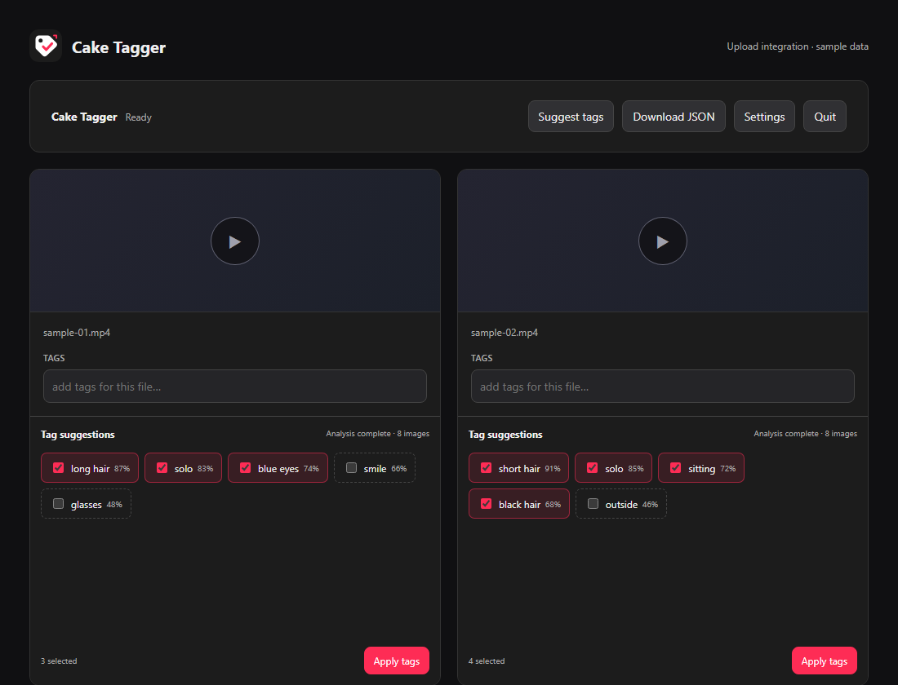

# Cake Tagger

Local AI-assisted video tagging for cake.ski. Get suggestions directly beside upload videos, review them and apply the tags you choose. Inference runs on your computer using Python and JoyTag.

[Download the latest release](https://github.com/Forsaken5687/Cake-Tagger/releases/latest) · [Install the extension](docs/BROWSERS.md) · [Report a bug](https://github.com/Forsaken5687/Cake-Tagger/issues/new/choose)

*Interface preview with sample data; no real videos or analysis results are shown.*

## Getting started

Requires **Windows x64** and **Firefox 140+** or **Chrome 120+**.

1. Download **Cake-Tagger.zip** and the separate extension ZIP for your browser from the [latest release](https://github.com/Forsaken5687/Cake-Tagger/releases/latest).
2. Extract both ZIPs and [install the extension](docs/BROWSERS.md).
3. Run **Cake-Tagger.exe** and leave its terminal open.
4. Select videos in cake.ski's upload area. New videos are analyzed automatically by default.
5. Review the suggestions and choose **Apply tags**. Add manual tags through the site's input.

The extension preserves existing tags and never publishes posts. **Bulk file selection can already upload drafts through cake.ski itself.**

Use **Download JSON** to keep results before closing or reloading the upload page. Stop the local service with **Quit** in the extension or **Ctrl+C** in its terminal.

## Settings and limits

Adjust sampling, CPU parallelism, suggestion thresholds, tag counts and exclusions in **Settings**. Preferences persist locally and are shared by connected browsers. See the [settings guide](docs/SETTINGS.md).

Scores are model signals, not probabilities of correctness. Sampled frames can miss short events or context; review suggestions before applying them. Videos must be at most 10 minutes, codec support depends on the browser, and image sets are unsupported. See [mapping coverage](docs/TAG_COVERAGE.md).

## Privacy

The browser decodes videos and sends sampled frames to the server on this computer. The inference server does not save videos or frames. Upload results remain in page memory; settings are saved locally. JSON exports contain filenames and tags. The development review tool also keeps a browser-local session backup.

See [security boundaries](docs/SECURITY.md) and [third-party components](THIRD_PARTY.md).

## Development

- In a fresh source checkout, run `scripts\launch.cmd setup`, then `runtime/cpython/python.exe scripts/build_launcher.py` to create `Cake-Tagger.exe`.
- Run `runtime/cpython/python.exe scripts/test.py` after code changes.
- The [reusable Python package](docs/PYTHON.md) can also be integrated into another backend.
- Build extensions with `runtime/cpython/python.exe scripts/build_extension.py firefox` or `runtime/cpython/python.exe scripts/build_extension.py chrome`.
- Run `runtime/cpython/python.exe scripts/package.py` to create the complete Windows ZIP and separate browser-extension ZIPs in `outputs/`. Share the packages, not the working directory.
- Open `http://127.0.0.1:8765/review.html` after starting the service for the [review lab](docs/REVIEW.md): video annotations, frame evidence and A/B rule comparisons. This tool and tests are excluded from releases.
- For performance troubleshooting, open [runtime diagnostics](http://127.0.0.1:8765/diagnostics.html) while the service is running.

Application code lives in `src/client/`, `src/server/` and `src/shared/`; browser integration lives in `extension/`. Documentation, tooling and tests are in `docs/`, `scripts/` and `tests/`. Private state, experiments and generated packages belong in ignored `data/`, `work/` and `outputs/`.

Further reading: [architecture](docs/TECHNICAL.md), [integration](docs/INTEGRATION.md), [testing](docs/TESTING.md).

## License

Cake Tagger's own code is available under the [MIT License](LICENSE). Bundled models and dependencies retain their [separate licenses](THIRD_PARTY.md). This is an independent project, not an official cake.ski application.
